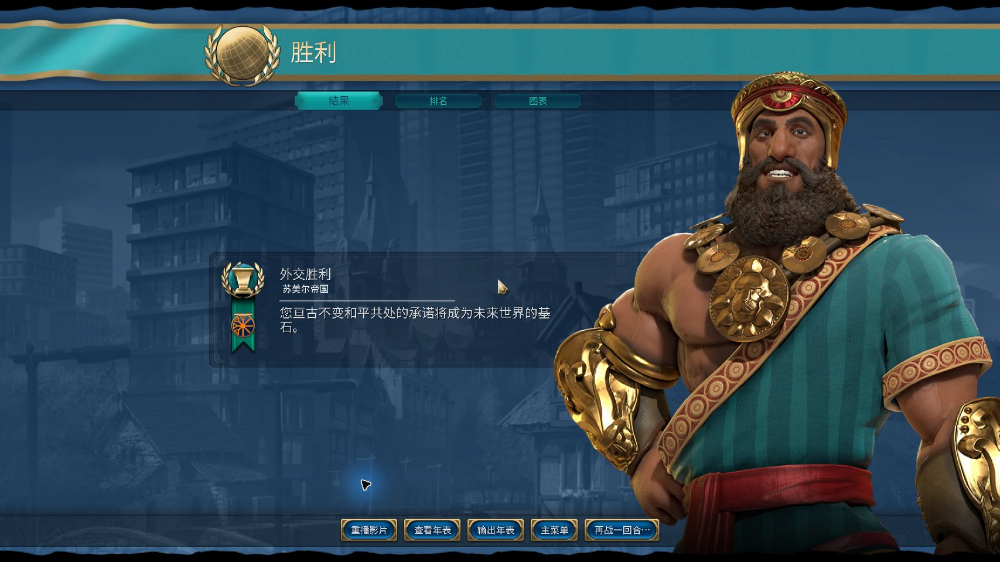

<div align="center">

# auto-civ6

**让 AI 在真实的《文明 VI》中规划、行动，走向胜利。**

</div>



<p align="center">
  <strong>神级 · 苏美尔／吉尔伽美什 · 外交胜利</strong><br>
</p>

## AI 如何玩这局游戏

`civ6-mcp` 通过 stdio 接入 MCP 客户端，通过本机 FireTuner 连接 Civilization VI。

模型负责策略，游戏引擎执行规则，运行层负责查询、提交动作与确认结果。

| 看清局面 | 执行决策 | 确认与恢复 |
| :--- | :--- | :--- |
| 查询城市、单位、地图、外交、世界排名与胜利进度 | 建设、研究、移动、战斗、宗教、交易和议会投票 | 核对动作是否生效；结果未知时追查原请求；从已确认检查点恢复 |

## 安装与启动

将下面这段提示词复制给 **Codex 或 Claude Code**：

```text
请帮我在本机安装并启动 https://github.com/Harryleft/auto-civ6，让我能在当前 Codex 或 Claude Code 中通过 MCP 操作《文明 VI：风云变幻》。先识别操作系统并检查已有环境；如果项目已在本地，复用现有目录。阅读 AGENTS.md 和 docs/installation.md，完成依赖安装、当前客户端的 civ6 MCP 配置、FireTuner 配置及游戏启动，保留其他已有配置和存档。需要重启或换档时遵循 docs/agent-recovery.md，仅加载我指定的存档，未指定时先问我。载入后调用 get_game_overview 验证连接与当前对局，确认后停下，不推进回合。缺少 Steam、游戏或必须由我完成的权限操作时，明确告诉我需要做什么；最后报告实际完成情况和剩余阻碍。
```

[安装与连接参考](docs/installation.md)

## 离线调试

在项目目录执行 `uv sync --locked`，然后使用 `uv run --locked civ6 doctor` 检查环境、知识包与 MCP 协议，使用 `uv run --locked civ6 verify knowledge` 验证知识查询。CLI 还提供领域测试和日志查询，统一输出 JSON 并保留证据；不操作真实游戏。完整命令见[离线调试 CLI](docs/cli.md)。

前台调试使用 `uv run --locked civ6 debug`，在同一 MCP 进程中查询状态、查看 pending 和显式调用工具；`debug --offline` 只允许知识查询与服务内存检查。实机操作仍按当前任务授权和存档规则执行，详见[会话说明](docs/cli.md#前台-debug-会话)。

## 开始使用

连接后，可向模型发送：

> 读取当前概览、单位和城市，根据真实状态完成当前回合；先解决阻塞，再推进回合。动作结果不明确时先查询确认。

---

本项目采用 [MIT License](LICENSE)。
