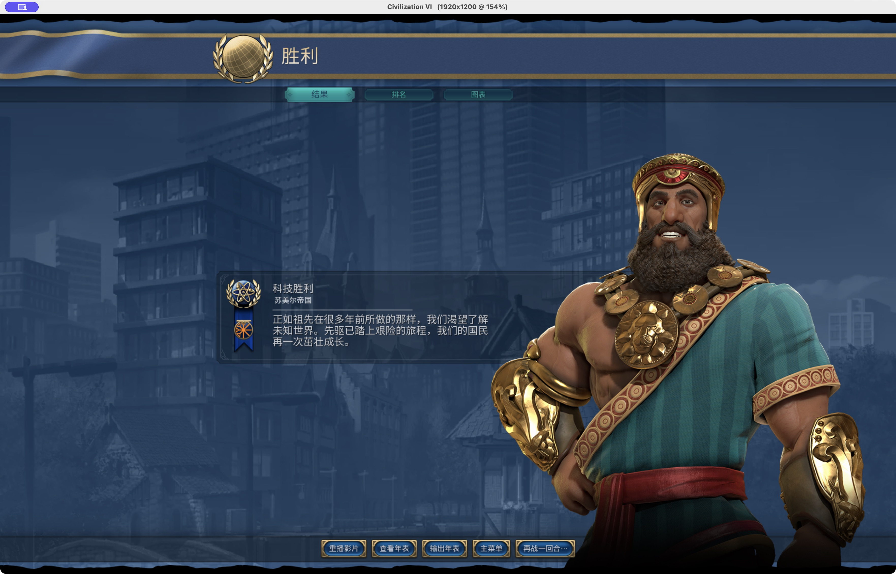

<div align="center">

# 文明 VI × AI

**让 AI 在真实的《文明 VI》中规划、行动，走向胜利。**

本机 MCP 服务 · 真实状态查询 · 动作结果确认 · 存档恢复

[对局实录](#对局实录) · [安装与启动](#安装与启动) · [开始使用](#开始使用) · [文档导航](docs/README.md)

</div>


<p align="center">
  <strong>神级 · 苏美尔／吉尔伽美什 · T243 外交胜利</strong><br>
  <sub>Windows 实机；截图为同局 T241→243 恢复复现补拍，原局终局日志独立保留。</sub>
</p>

## AI 如何玩这局游戏

`civ6-mcp` 通过 stdio 接入 MCP 客户端，通过本机 FireTuner 连接 Civilization VI。模型负责策略，游戏引擎执行规则，运行层负责查询、提交动作与确认结果。

| 看清局面 | 执行决策 | 确认与恢复 |
| :--- | :--- | :--- |
| 查询城市、单位、地图、外交、世界排名与胜利进度 | 建设、研究、移动、战斗、宗教、交易和议会投票 | 核对动作是否生效；结果未知时追查原请求；从已确认检查点恢复 |

游戏操作需要在本机运行游戏；离线规则知识查询无需启动游戏。

## 对局实录

以下三次主线均使用苏美尔／吉尔伽美什，对手为巴西、瑞典和加拿大，规则为《风云变幻》；两个神级轮次从同一原始基准分别开始。过程中包含工具修复、技术恢复与人工协助。

| 难度与地图 | 终局 | 过程与证据 |
| :--- | :--- | :--- |
| **不朽** · 快速 · 极小盘古大陆 | **T233 · 科技胜利** | [轮次记录](games/benchmark-sumeria-719665280/runs/2026-10-18-t233/README.md) · [胜利复盘](games/benchmark-sumeria-719665280/runs/2026-10-18-t233/reports/2026-10-19-victory-analysis.md) |
| **神级** · 快速 · 极小四叶草 · 第一次主线 | T141 · 瑞典宗教胜利，本方失败 | [失败复盘](games/2026-10-19-gold/runs/2026-10-19-first/reports/religious-defeat-postmortem.md) |
| **神级** · 快速 · 极小四叶草 · 第二次主线 | **T243 · 外交胜利** | [终局报告](games/2026-10-19-gold/runs/2026-10-20-windows-full-game-01/reports/final.md) · [截图复现记录](games/2026-10-19-gold/runs/2026-10-20-windows-full-game-01/reports/2026-10-21-victory-reproduction/README.md) |

<details>
<summary><strong>查看不朽 T233 科技胜利截图</strong></summary>



</details>

更多轮次、修复记录与存档入口见[对局资料](games/README.md)。

## 安装与启动

需要 **Python 3.12+**、[uv](https://docs.astral.sh/uv/)、支持 stdio 的 MCP 客户端，以及 **Steam 版 Civilization VI：Gathering Storm（风云变幻）**。支持 macOS 和 Windows。

### 1. 安装项目

```bash
git clone https://github.com/Harryleft/auto-civ6.git
cd auto-civ6
uv sync --locked
```

### 2. 配置游戏

启用 FireTuner，关闭自动结束回合，重启游戏并加载存档。FireTuner 使用本机 TCP 端口 `4318`。

| 平台 | 配置与启动说明 |
| :--- | :--- |
| macOS | [Steam 与 Aspyr 启动设置](docs/research/bypassing_aspyr_launcher.md) |
| Windows | [安装、FireTuner、中文编码与存档目录](docs/windows.md) |

### 3. 配置 MCP 客户端

以 Codex 为例，在配置中填写项目的绝对路径：

```toml
[mcp_servers.civ6]
command = "uv"
args = ["run", "--locked", "--directory", "/absolute/path/to/auto-civ6", "civ-mcp"]

[mcp_servers.civ6.env]
PYTHONUTF8 = "1"
```

Windows 路径示例与超时设置见[Windows 运行说明](docs/windows.md#安装与连接)。其他 stdio MCP 客户端使用相同入口，也可参考 [.mcp.json](.mcp.json)。客户端会启动服务；手动启动可运行 `uv run --locked civ-mcp`。更新代码后，重新加载 MCP 服务以使用新版本。

## 开始使用

连接后，可向模型发送：

> 读取当前概览、单位和城市，根据真实状态完成当前回合；先解决阻塞，再推进回合。动作结果不明确时先查询确认。

以获胜为目标开局或续局时，先读[策略检查清单](docs/agent-checklist.md)，持续关注本方瓶颈、对手排名与各条胜利条件。动作结果不明确时，保留未决请求并只读核对，避免重复提交。

## 按需查阅

| 需要做什么 | 从这里开始 |
| :--- | :--- |
| 让 AI 了解项目约束 | [AGENTS.md](AGENTS.md) |
| 操作单位、城市与回合 | [游戏操作指南](docs/agent-playbook.md) |
| 处理议会、交易、外交与强制选择 | [特殊操作指南](docs/agent-special-operations.md) |
| 保存、读档与故障恢复 | [保存与恢复](docs/agent-recovery.md) |
| 查询文明、领袖与离线规则 | [知识 MCP](civ6_knowledge/README.md#mcp-查询) |
| 修改代码、运行测试或理解架构 | [开发与验证](docs/development.md) · [当前架构](docs/architecture.md) |

[完整文档导航](docs/README.md) · [术语表](GLOSSARY.md) · [基准存档](fixtures/saves/README.md) · [对局资料](games/README.md)

---

本项目采用 [MIT License](LICENSE)。
